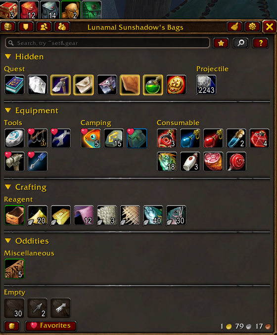
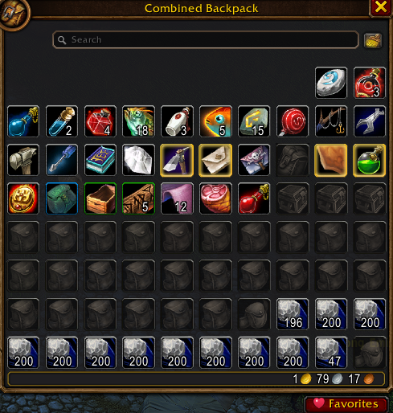
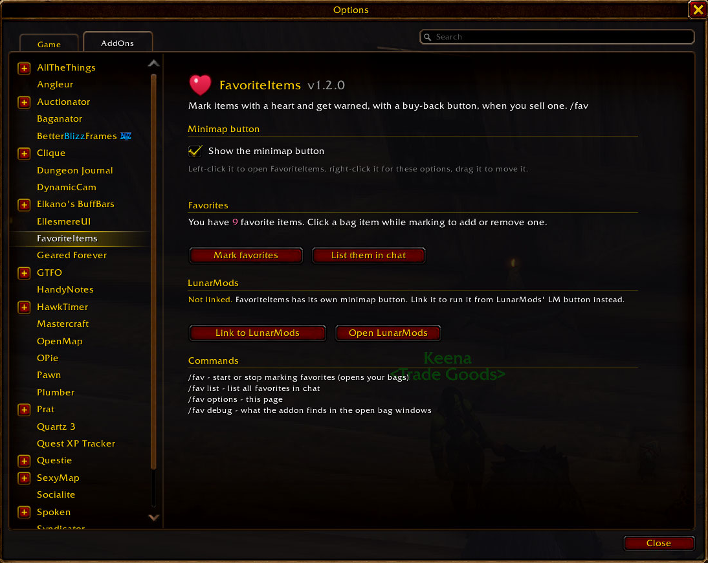

<!-- Description for the CurseForge project page (paste as Markdown).
     Upload the PNGs in screenshots/ to the project's Images tab too; the
     links below point at the GitHub copies. -->

# FavoriteItems

**Mark items with a heart and get warned before you sell, disenchant or mail one by mistake.**

Mark the items you care about with a little heart. If one of them is about to be disenchanted or mailed, FavoriteItems warns you while there's still time to stop. If one ends up sold to a vendor anyway, it tells you right away and lets you buy it back with one click.

*With Baganator: hearts on favorite items, and the Favorites button in the bag window's bottom row.*

*With the default bags: the Favorites button under the combined backpack.*

## Features

- **Favorites button** on the lower side of your bags and bank.
- **Click to mark**: press the button, then click items to mark or unmark them. A heart appears in the icon's upper left corner. Press **Done** or close your bags when you're finished.
- **Specific items, not item types**: mark one copy of an item and the other copies stay unmarked.
- **Sold warning**: sell a favorite and a warning pops up with a **Buy back** button, plus a raid-warning message and sound. It catches every way of selling: right-click, dragging onto the vendor, and junk sellers.
- **Bought back = still a favorite**: buy it back before you leave the vendor and the heart comes back.
- **Disenchant warning**: start disenchanting a favorite and you get a warning while the cast is still going, with a **Stop casting** button (moving or pressing Esc works too). While you're choosing what to disenchant, a favorite's tooltip says "Don't disenchant this one!"
- **Mail warning**: put a favorite in a letter and a warning pops up. The **Send** button stays off until you pick **Remove it** or **Send anyway**.
- **Tooltip line** showing "Favorite" on marked items.
- **Minimap button** (the heart): left-click starts or stops marking, hover shows how many favorites you have, right-click opens the options.

## Options

Right-click the minimap button, type `/fav options`, or open the game's Options → AddOns → FavoriteItems.

- **Show the minimap button**: switch the heart button off if you'd rather use `/fav`.
- **Mark favorites** and **List them in chat**.
- With **TradeSkillMaster** loaded: **Add favorites to Do Not Sell** and a reminder when a new favorite isn't in that group yet.

## TradeSkillMaster

TSM doesn't let other addons change its groups, so `/fav tsm` gives you an import line with the favorites that aren't in TSM's **Do Not Sell** group yet. Copy it (Ctrl+C), then in TSM open **Groups → Import group** and paste it. Give the Do Not Sell group a Vendoring operation with **Enable selling** off. Later imports are named "Do Not Sell 1" and so on; drag them onto Do Not Sell to make them subgroups. TSM groups hold item types, so every copy of a favorite's item is included.

## Commands

| Command | What it does |
|---|---|
| `/fav` or `/favorites` | Start or stop marking (opens your bags) |
| `/fav list` | List your favorites in chat |
| `/fav options` | Open the options |
| `/fav tsm` | Add favorites to TradeSkillMaster's Do Not Sell group (import line) |
| `/fav debug` | What the addon finds in the open bag windows |

## Compatibility

- Made for **World of Warcraft: Forever**.
- Works with **Baganator**: the heart is a Baganator corner widget, so you can move it under Baganator's settings → Icons.
- Without Baganator it uses the default bags and bank.
- Optional **TradeSkillMaster** support: a Do Not Sell group for your favorites.
- Favorites and options are shared by all characters on your account.
- Addons can't block a spell, so the disenchant warning comes during the cast; an instant disenchant from another addon only gets a message afterwards. Mass-mail addons skip the Send button, so for them you're told after the letter has gone.

## Changes

See [CHANGELOG.md](https://github.com/Lundqwist/FavoriteItems/blob/main/CHANGELOG.md).

## Source

GitHub: https://github.com/Lundqwist/FavoriteItems
