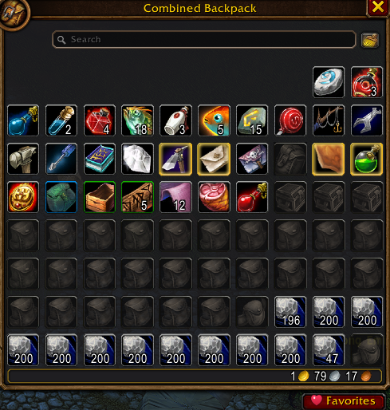
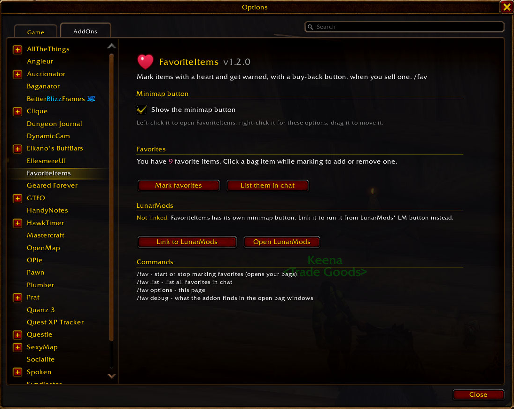

# FavoriteItems

**Mark items with a heart and get warned before you sell, disenchant or mail one by mistake.**

A World of Warcraft: Forever addon (interface 16001).

*With Baganator: favorites get a heart, and the **Favorites** button sits in the bag window's bottom row.*

*Without Baganator: the **Favorites** button sits under the default combined backpack.*

## Features

- A **Favorites** button sits on the lower side of the bag window (in Baganator's bottom button row, or under the default bags) and under the bank window.
- Click it, then click items to mark or unmark them. Favorites get a small heart in the icon's upper left corner. Click **Done** (or close the bags) to stop.
- Sell a favorite to a merchant and a warning pops up, with a **Buy back** button while the merchant is still open. A raid-warning message and sound go with it.
- Start disenchanting a favorite and a warning pops up during the cast, with a **Stop casting** button (moving or Esc works too). If the cast finishes, the item is dropped from your favorites. While you're choosing what to disenchant, a favorite's tooltip says "Don't disenchant this one!"
- Attach a favorite to a letter and a warning pops up; the **Send** button stays off until you pick **Remove it** or **Send anyway**. Letters sent by mass-mail addons skip the button; you get a chat message afterwards.
- Item tooltips show a "Favorite" line.

Both of these rely on the game locking an item while a spell is cast on it or while it sits in an unsent letter. Addons can't block a spell, so the disenchant warning comes during the cast, not before it.
- A **minimap button** (the heart): left-click starts or stops marking, hover shows how many favorites you have, right-click opens the options, drag moves it.

Favorites are specific items, not item types: each is saved by its item GUID in `FavoriteItemsDB`, so marking one copy of an item leaves the other copies unmarked. Only items the current character holds (bags, or the bank while it's open) can be marked; other characters' bags shown from Baganator's cache can't. If a sold favorite is bought back while the merchant is still open, it's marked again.

Works with Baganator (the heart is a Baganator corner widget: it can be moved under Baganator's settings → Icons) and falls back to the default Blizzard bags and bank when Baganator isn't enabled.

## Options

Right-click the minimap button, type `/fav options`, or open Options → AddOns → FavoriteItems.

- **Show the minimap button**
- **Mark favorites**, **List them in chat**
- With **TradeSkillMaster** loaded: how many favorites are in TSM's **Do Not Sell** group, an **Add favorites to Do Not Sell** button, and **Remind me when a new favorite isn't in the Do Not Sell group** (on by default, at most one chat line a minute)

## TradeSkillMaster: Do Not Sell group

TSM lets other addons read its groups but not change them, so FavoriteItems builds a TSM import line for you: `/fav tsm` (or the button in the options) opens a window with the favorites that aren't in the group yet, already selected. Press Ctrl+C, then in TSM (`/tsm`) open **Groups**, click **Import group** above the group list, paste with Ctrl+V and import.

- The first import creates a group called **Do Not Sell**. Give it a Vendoring operation with **Enable selling** off, so TSM's vendoring leaves those items alone.
- Later imports hold only the new favorites. TSM names them **Do Not Sell 1**, **Do Not Sell 2** and so on; drag one onto **Do Not Sell** to make it a subgroup that shares its operations. All of these, and their subgroups, count as the Do Not Sell group.
- TSM groups hold item types, not single items, so every copy of a favorite's item ends up in the group.

## Commands

| Command | What it does |
|---|---|
| `/fav` or `/favorites` | Start or stop marking (opens your bags) |
| `/fav list` | List your favorites in chat |
| `/fav options` | Open the options |
| `/fav tsm` | Copy the favorites missing from TSM's Do Not Sell group, for TSM's Import group box |
| `/fav debug` | What the addon finds in the open bag windows |

## Install

Copy the `FavoriteItems` folder (with `FavoriteItems.toc`, `LunarLink.lua`, `FavoriteItems.lua` and `Media`) into `World of Warcraft\_forever_\Interface\AddOns\`, or run `.\install.ps1` from a clone (it links the clone into the game). Then `/reload` in game.

## For developers

`LunarLink.lua` (minimap button and options page) is the same file in each of my mods (FavoriteItems, QuestXPTracker, LunarJournal); keep the copies alike. The description for CurseForge is in [CURSEFORGE.md](CURSEFORGE.md); `.\tools\package.ps1` builds the upload zip in `curseforge\`. Changes per version are in [CHANGELOG.md](CHANGELOG.md).

## License

[MIT](LICENSE) © 2026 Bjarne Lundqwist
