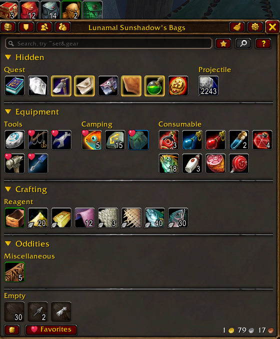

# FavoriteItems

**Mark items with a heart and get warned, with a buy-back button, when you sell one.**

A World of Warcraft: Forever addon (interface 16001). Works on its own, or together with [LunarMods](https://github.com/Lundqwist/LunarMods).

*With Baganator: favorites get a heart, and the **Favorites** button sits in the bag window's bottom row.*

*Without Baganator: the **Favorites** button sits under the default combined backpack.*

## Features

- A **Favorites** button sits on the lower side of the bag window (in Baganator's bottom button row, or under the default bags) and under the bank window.
- Click it, then click items to mark or unmark them. Favorites get a small heart in the icon's upper left corner. Click **Done** (or close the bags) to stop.
- Sell a favorite to a merchant and a warning pops up, with a **Buy back** button while the merchant is still open. A raid-warning message and sound go with it.
- Item tooltips show a "Favorite" line.
- A **minimap button** (the heart): left-click starts or stops marking, hover shows how many favorites you have, right-click opens the options, drag moves it.

Favorites are specific items, not item types: each is saved by its item GUID in `FavoriteItemsDB`, so marking one copy of an item leaves the other copies unmarked. Only items the current character holds (bags, or the bank while it's open) can be marked; other characters' bags shown from Baganator's cache can't. If a sold favorite is bought back while the merchant is still open, it's marked again.

Works with Baganator (the heart is a Baganator corner widget: it can be moved under Baganator's settings → Icons) and falls back to the default Blizzard bags and bank when Baganator isn't enabled.

## Options and LunarMods

Right-click the minimap button, type `/fav options`, or open Options → AddOns → FavoriteItems.

- **Show the minimap button**
- **Mark favorites**, **List them in chat**
- **Link to LunarMods**: with LunarMods installed, this hides FavoriteItems' own minimap button and lets LunarMods' **LM** button run it instead (its right-click menu opens it, its tooltip shows the favorites count). **Unlink from LunarMods** gives the heart button back. LunarMods' `/lm` list switches FavoriteItems on and off whether it's linked or not. Without LunarMods the link button is greyed out and FavoriteItems works on its own.

## Commands

| Command | What it does |
|---|---|
| `/fav` or `/favorites` | Start or stop marking (opens your bags) |
| `/fav list` | List your favorites in chat |
| `/fav options` | Open the options |
| `/fav debug` | What the addon finds in the open bag windows |

## Install

Copy the `FavoriteItems` folder (with `FavoriteItems.toc`, `LunarLink.lua`, `FavoriteItems.lua` and `Media`) into `World of Warcraft\_forever_\Interface\AddOns\`, or run `.\install.ps1` from a clone (it links the clone into the game). Then `/reload` in game.

## For developers

`LunarLink.lua` (minimap button, options page, LunarMods link) is a copy of `shared\LunarLink.lua` in the [LunarMods](https://github.com/Lundqwist/LunarMods) repository; change it there and copy it over with `tools\sync-link.ps1`. The description for CurseForge is in [CURSEFORGE.md](CURSEFORGE.md).

## License

[MIT](LICENSE) © 2026 Bjarne Lundqwist
